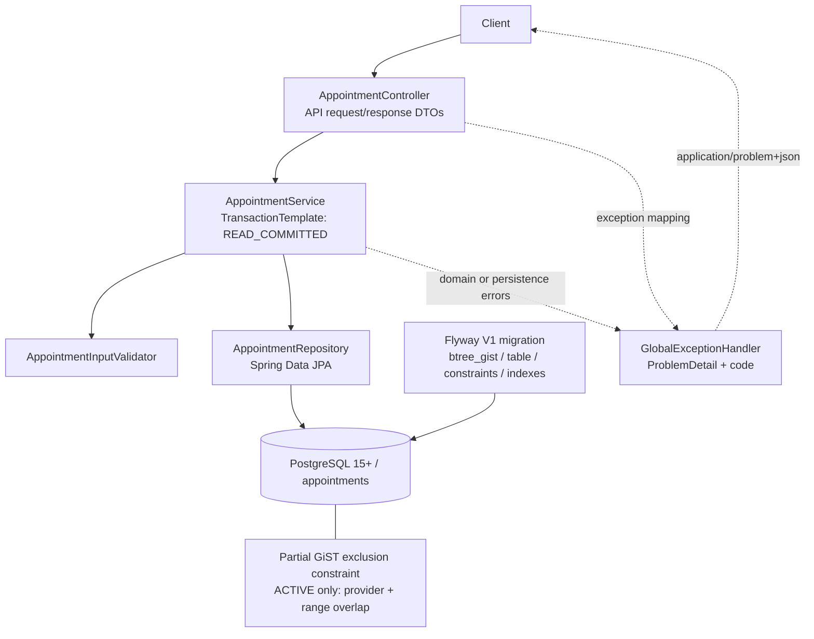
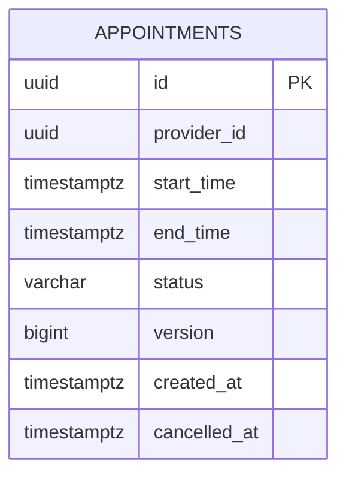

# Appointment booking and cancellation — design

## Scope and service boundary

This service slice books and cancels appointments for a provider. It does **not** manage providers, availability schedules, authentication, notifications, recurring bookings, calendars, or a frontend. The client supplies a provider UUID; the service does not check a provider registry.

Java 17 / Spring Boot 3.x exposes two REST endpoints. The controller and API DTOs are in `com.example.scheduler.api`; the service owns validation orchestration and transaction boundaries; the repository owns JPA persistence; the domain contains the entity, status, data snapshot, and domain exceptions; `config` supplies a UTC clock. JPA entities are never serialized as API responses.

The implementation reviewed for this document is the **stage-2 project archive**. Design details below describe that code; they do **not** imply it passed end-to-end or concurrency tests.

## Booking invariant

For distinct appointments `A` and `B`, the following must never both be true in committed database state:

- `A.provider_id = B.provider_id`
- `A.status = 'ACTIVE'` and `B.status = 'ACTIVE'`
- `A.start_time < B.end_time` and `B.start_time < A.end_time`

Intervals are half-open `[start, end)`: `[10:00, 11:00)` and `[11:00, 12:00)` are adjacent, not overlapping. A cancelled row remains stored but does not block new bookings. Different provider UUIDs do not conflict.

Flyway V1 installs `btree_gist` and the constraint `appointments_no_active_overlap`:

```sql
EXCLUDE USING GIST (
    provider_id WITH =,
    tstzrange(start_time, end_time, '[)') WITH &&
) WHERE (status = 'ACTIVE')
```

The constraint, not a prior `SELECT`, is the final authority under concurrency. The schema also checks `end_time > start_time`, permitted statuses, nonnegative version, and consistency between cancellation status and `cancelled_at`.

## API and error contract

| Operation | Endpoint | Request | Success |
| --- | --- | --- | --- |
| Book | `POST /api/v1/appointments` | JSON strings `providerId`, `startTime`, `endTime` | `201 Created`, appointment response body and `Location` header |
| Cancel | `POST /api/v1/appointments/{id}/cancel` | UUID path ID; no body | `200 OK`, updated appointment response body |

The response DTO contains `id`, `providerId`, `startTime`, `endTime`, `status`, `createdAt`, `cancelledAt`. The JPA `version` field is internal.

Expected error responses use `application/problem+json` (RFC 7807-compatible `ProblemDetail`, with extension `code`, HTTP status, detail and instance):

| Status | Domain error codes | Meaning |
| --- | --- | --- |
| 400 | `INVALID_REQUEST`, `INVALID_TIMESTAMP`, `INVALID_INTERVAL`, `INVALID_APPOINTMENT_ID` | Missing/malformed fields, UTC timestamp or UUID, or nonpositive duration |
| 404 | `APPOINTMENT_NOT_FOUND` | No appointment with the cancellation ID |
| 409 | `APPOINTMENT_CONFLICT` | ACTIVE overlap detected either by preliminary check or exclusion constraint |
| 409 | `ALREADY_CANCELLED` | Appointment exists but is already cancelled, including identified concurrent cancellation |
| 409 | `CONCURRENT_MODIFICATION` | An optimistic-lock failure not resolved as missing/already cancelled |

Unexpected infrastructure failures are not intentionally mapped to a domain 409. A repeated successful booking request is not idempotent at the API level; see `LIMITATIONS.md`.

## Data model

One Flyway-managed `appointments` table:

| Column | Type | Rules |
| --- | --- | --- |
| `id` | `uuid` | Primary key; application generates UUID |
| `provider_id` | `uuid` | Not null; no foreign key because provider management is outside this slice |
| `start_time`, `end_time` | `timestamptz(6)` | Not null, positive interval |
| `status` | `varchar(16)` | `ACTIVE` / `CANCELLED`; initially ACTIVE |
| `version` | `bigint` | Not null, nonnegative; JPA `@Version` for row updates |
| `created_at` | `timestamptz(6)` | Not null |
| `cancelled_at` | `timestamptz(6)` | Null while ACTIVE; nonnull while CANCELLED |

Indexes: UUID primary key, GiST index supplied by exclusion constraint, and a separate partial B-tree index `appointments_active_provider_start_idx` on `(provider_id, start_time)` for ACTIVE rows. The benefit of the extra index has not been measured.

## Booking and cancellation transactions

**Booking:** The service parses identifiers and timestamp strings before opening a transaction. It uses a `TransactionTemplate` transaction with `READ_COMMITTED` isolation, queries for an early friendly overlap error, creates an ACTIVE appointment, and calls `saveAndFlush`. The DB can still reject the insert if a concurrent transaction creates a conflict. After the transaction fails and rolls back, the service recognizes SQLSTATE `23P01` associated with the exclusion constraint and raises `APPOINTMENT_CONFLICT`. The transaction is **not** queried or reused after a failed SQL statement.

**Cancellation:** The service validates the appointment ID, fetches the entity, returns `APPOINTMENT_NOT_FOUND` if absent or `ALREADY_CANCELLED` if already cancelled, then sets status and cancellation time and flushes. Entity `@Version` protects concurrent row updates. On an optimistic-lock exception, it reads state using a **new** transaction: missing yields 404, CANCELLED yields `ALREADY_CANCELLED`, and another state yields `CONCURRENT_MODIFICATION`. No separate provider lock or advisory lock is used.

`TransactionTemplate` with `PROPAGATION_REQUIRES_NEW` is used in the service rather than `@Transactional` on controller/repository methods. This keeps rollback complete before domain exception translation or the cancellation recovery read.

## Why PostgreSQL, and rejected alternatives

PostgreSQL 15+ is a deliberate choice: `tstzrange`, partial GiST exclusion constraints, and `btree_gist` directly express the central cross-row invariant in the database. This works across separate application instances, regardless of timing of the optional early overlap query. Tradeoffs: reduced database portability, extension requirements, and database-specific constraint error handling. Flyway owns schema evolution; Hibernate uses `ddl-auto: validate`, not schema generation.

| Alternative | Decision | Reason |
| --- | --- | --- |
| Provider-row pessimistic lock | Not selected | Requires a stable provider row, which this slice does not manage; cooperative lock protocol still needed |
| Transaction advisory lock (`pg_advisory_xact_lock`) | Not selected | All writers must follow the same keyed protocol; UUID-to-lock-key mapping and unnecessary contention add complexity |
| `@Version` alone | Insufficient for booking | Protects updates of one existing row, not concurrent inserts into distinct appointment rows; retained for cancellation |
| `SERIALIZABLE` + transaction retry | Not selected | Can prevent write skew if all writers correctly read/check, but adds retry/abort complexity for an invariant expressed directly by exclusion |
| Application overlap query alone | Not sufficient | Two concurrent readers can both see no match and insert; retained only for friendly early errors |

## Mermaid architecture

### 1. Layered component diagram



*The exception handler is a side path, not a normal sequential processing step between the controller and service.*

### 2a. Sequence — successful booking

```mermaid
sequenceDiagram
    actor Client
    participant API as Controller
    participant S as Service / TransactionTemplate
    participant V as Validator
    participant R as Repository
    participant DB as PostgreSQL
    Client->>API: POST /api/v1/appointments
    API->>S: book(providerId, startTime, endTime)
    S->>V: Parse UUID and UTC instants; check start < end
    V-->>S: Validated booking input
    S->>DB: BEGIN (READ COMMITTED)
    S->>R: hasActiveOverlap(provider, start, end)
    R->>DB: SELECT EXISTS (ACTIVE range overlap)
    DB-->>R: false
    R-->>S: false
    S->>R: saveAndFlush(ACTIVE appointment)
    R->>DB: INSERT; enforce exclusion constraint
    DB-->>R: Success
    S->>DB: COMMIT
    S-->>API: AppointmentDetails
    API-->>Client: 201 Created + AppointmentResponse
```

### 2b. Sequence — concurrent overlap conflict

```mermaid
sequenceDiagram
    actor A as Client A
    actor B as Client B
    participant T1 as Booking transaction T1
    participant T2 as Booking transaction T2
    participant DB as PostgreSQL / GiST constraint
    A->>T1: Book P1 [10:00,11:00)
    B->>T2: Book P1 [10:30,11:30)
    T1->>DB: BEGIN; early overlap check
    DB-->>T1: No ACTIVE overlap (yet)
    T2->>DB: BEGIN; early overlap check
    DB-->>T2: No ACTIVE overlap (yet)
    T1->>DB: INSERT ACTIVE row A
    DB-->>T1: Insert accepted (uncommitted)
    T2->>DB: INSERT ACTIVE row B
    Note over T2,DB: May wait for competing transaction outcome
    T1->>DB: COMMIT
    DB-->>T1: Committed
    DB-->>T2: SQLSTATE 23P01 (exclusion violation)
    T2->>DB: ROLLBACK
    T1-->>A: 201 Created
    T2-->>B: 409 APPOINTMENT_CONFLICT
```

*The sequence shows one valid interleaving; either client could win. The `23P01` mapping happens after the failed transaction has ended.*

### 3. ER diagram



`provider_id` is an identifier, not an enforced foreign key in this slice. The ACTIVE-only non-overlap constraint and the `[)` range expression are expressed in the migration, not in Mermaid ER notation.

## Assumptions and verification status

- UTC only. Input requires uppercase `Z`, seconds, and at most six fractional-second digits; `Instant` is used in domain/service code. PostgreSQL timestamps have microsecond precision.
- Past and arbitrarily long positive-duration appointments are permitted under the current rules. Only `ACTIVE` and `CANCELLED` exist; cancellation is terminal; interval editing is unsupported.
- The early overlap check is advisory: it may race with cancellation, but committed double-booking prevention belongs to the database constraint.
- Tests for overlap binding, real concurrency, optimistic-lock exception translation, and full Maven/PostgreSQL startup **have not yet been demonstrated**. Accepted review items H1–H4 and timestamp-hardening M1/M2 remain follow-up work, not completed fixes.
- The current timestamp parser can normalize some unusual literals; the runtime may emit nanosecond audit timestamps before database microsecond storage. Neither issue should be represented as resolved.
